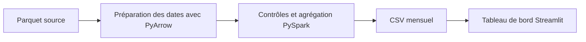

# Analyse du trafic portuaire au Maroc

Pipeline de données qui transforme des observations journalières d’IMF PortWatch en indicateurs mensuels par port. Le tableau de bord Streamlit permet de comparer l’activité de Casablanca, Tanger Med et d’autres ports marocains.

## Architecture



| Fichier | Rôle |
|---|---|
| `src/inspect_data.py` | Vérifie la lecture du Parquet et affiche les jours les plus chargés à Casablanca. |
| `src/analyse_mensuelle.py` | Prépare les dates UTC, filtre les lignes invalides, déduplique les observations et calcule les agrégats mensuels. |
| `dashboard/app.py` | Affiche une courbe par port, des filtres par année et un tableau de couverture. |

## Démarrage sur Windows

Utiliser Python 3.13 et Java 17. Depuis la racine du projet, installer les dépendances.

```powershell
py -m pip install pyspark==4.0.1 pyarrow pandas streamlit
java -version
```

Télécharger [le fichier Parquet de référence](https://huggingface.co/datasets/electricsheepafrica/africa-ports-morocco/resolve/main/data/train-00000-of-00001.parquet) et enregistrer une seule copie sous `data/raw/ports_maroc.parquet/train-00000-of-00001.parquet`. `ports_maroc.parquet` est le nom du dossier attendu par les scripts.

```powershell
py .\src\inspect_data.py
py .\src\analyse_mensuelle.py
py -m streamlit run .\dashboard\app.py
```

Ouvrir [le tableau de bord local](http://localhost:8501). Le traitement génère `data/processed/ports_journaliers.parquet` et `data/processed/escales_mensuelles.csv`.

Si PySpark renvoie `WinError 2` au démarrage sur Windows, vérifier que `SPARK_HOME` pointe vers une installation valide. Avec l’installation par `pip`, la commande `Remove-Item Env:SPARK_HOME -ErrorAction SilentlyContinue` permet de revenir au lanceur fourni par le paquet dans le terminal courant. Vérifier également que `JAVA_HOME` pointe vers la racine du JDK 17.

## Indicateurs et qualité des données

- Le total mensuel additionne les escales quotidiennes pour chaque port.
- La moyenne quotidienne est calculée sur les jours observés. Un mois partiel peut afficher un total inférieur même si le rythme quotidien est similaire.
- Après suppression des doublons exacts, le traitement s’arrête si plusieurs observations différentes partagent le même identifiant de port et la même date.
- Les données sont agrégées par port et par jour. Le tableau de bord mesure l’activité portuaire. Le temps d’attente avant la mise à quai nécessiterait des horodatages par escale.

Source des observations journalières · [IMF PortWatch](https://portwatch.imf.org/). Fichier de travail · [africa-ports-morocco](https://huggingface.co/datasets/electricsheepafrica/africa-ports-morocco).

Projet portfolio de Salma Nasserallah.

